# Procurement Process Flow Diagram

```mermaid
flowchart TD
    A([Start]) --> B[Maintain Procurement Setup<br/>Number series, approval thresholds, templates]
    B --> C[Create Store Requisition<br/>Store Requisition Card]
    C --> D[Add Requisition Lines]
    D --> E[Release Requisition]
    E --> F{Approval Workflow Enabled?}

    F -- No --> G[Status = Approved]
    F -- Yes --> H[Status = Pending Approval]
    H --> I{All Required Approvals Complete?}
    I -- No --> H
    I -- Yes --> G

    G --> J{Items In Stock?}
    J -- Yes --> K[Post Store Requisition<br/>Issue from inventory]
    J -- No --> L[Auto-create External Requisition<br/>for out-of-stock lines]

    L --> M[Review External Requisition]
    M --> N[Release External Requisition]
    N --> O{Approval Workflow Enabled?}
    O -- No --> P[Status = Approved]
    O -- Yes --> Q[Status = Pending Approval]
    Q --> R{All Required Approvals Complete?}
    R -- No --> Q
    R -- Yes --> P

    P --> S[Create RFQ from External Requisition]
    S --> T[Open RFQ Card<br/>set Matrix Type + Scoring Document Type]
    T --> U[Optional: Maintain Scoring Criteria Setup]
    U --> V[Send RFQ to Vendors]
    V --> W[Capture Vendor Quotations]
    W --> X[Evaluate Quotations]
    X --> Y{Qualified Vendor Ranked #1?}
    Y -- No --> W
    Y -- Yes --> Z[Award Vendor]

    Z --> AA[Create LPO from Awarded Quotation]
    AA --> AB[Release LPO]
    AB --> AC{Approval Workflow Enabled?}
    AC -- No --> AD[Status = Approved]
    AC -- Yes --> AE[Status = Pending Approval]
    AE --> AF{All Required Approvals Complete?}
    AF -- No --> AE
    AF -- Yes --> AD

    AD --> AG[Create Purchase Order]
    AG --> AH[Receive Goods/Services<br/>Goods Receipt Note]
    AH --> AI[Verify GRN]
    AI --> AJ[Post GRN]
    AJ --> AK([End])
```

## Notes
- RFQ scoring is dynamic and read from `RFQ Scoring Criteria Setup`.
- RFQ/RFP disqualification thresholds are also read from setup.
- Approval steps depend on `Enable Approval Workflow` and threshold configuration.
